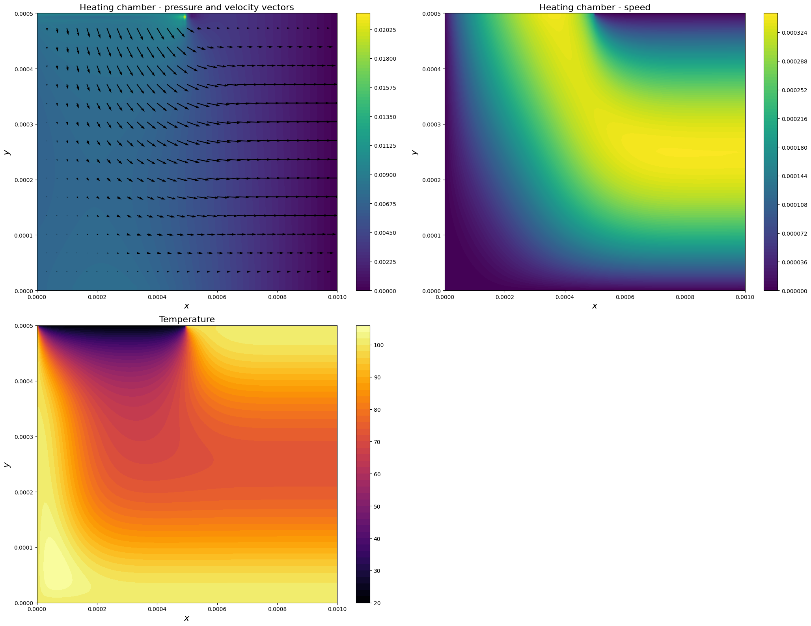
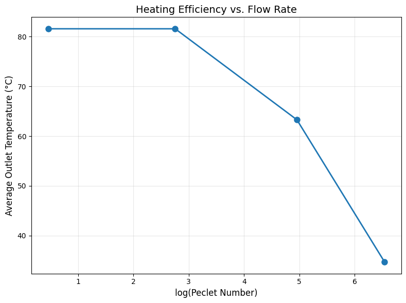

# Liquid Stream: Microwave-Heated Microfluidic Chamber

Finite-difference simulation of water flowing through a 1 mm × 0.5 mm microfluidic chamber while it is heated by hot walls and a uniform microwave source. The solver couples the incompressible Navier–Stokes equations with an advection–diffusion equation for temperature that includes a volumetric heat-source term.

Built for the *Modelling and Numerical Methods* module (MSc Applied Computational Science and Engineering, Imperial College London, January 2026).



## Model

- **Geometry:** inlet on the left half of the top wall, outlet along the right wall, no-slip on all other walls.
- **Flow:** incompressible Navier–Stokes, solved with a projection (pressure-correction) method. The pressure Poisson equation uses a Jacobi iteration with a relative-tolerance stopping rule. Flow is driven by a fixed inlet–outlet pressure difference.
- **Heat:** advection–diffusion of temperature with a source term $q = P / (L_x L_y)$ for microwave power $P$. Walls are held at 100 °C and the inflow at 20 °C. Temperature is one-way coupled: it is advected by the flow but does not feed back into it.
- **Discretisation:** explicit time stepping on a collocated grid with central differences. The Courant (CFL) and diffusion-number stability criteria are checked and reported for each run. The temperature update is vectorised with NumPy.

## Checks and diagnostics

- **Mass conservation:** volumetric inflow and outflow are integrated over the boundaries; they agree to within ~1% (1.138e-7 vs 1.147e-7 m²/s).
- **Dimensionless groups:** Reynolds, Péclet and Damköhler numbers are computed from the solved fields.
- **Outflow temperature:** flux-weighted average over the outlet.

## Results

| Study | Finding |
|---|---|
| Péclet sweep (inlet pressure 0.01 → 10 Pa) | Outlet temperature falls from 81.6 °C (Pe ≈ 1.6, balanced) to 35.6 °C (Pe ≫ 1, advection-dominated) |
| Damköhler sweep (microwave power) | Da ≪ 1 leaves an unheated core; Da ≫ 1 approaches thermal equilibrium. Neither extreme is practical |
| Numerical artefacts | Checkerboard pressure near the inlet from collocated pressure and velocity nodes; CFL becomes the binding limit at high Re |



## Run

```bash
uv sync            # or: pip install numpy scipy matplotlib ipykernel
jupyter lab liquid_stream.ipynb
```

One run at the default resolution (151 × 75) takes about 40 s on a laptop.

## Possible extensions

Staggered grid (removes the pressure checkerboard), higher-order schemes, adaptive time step from CFL and diffusion limits, a better initial guess for pressure and temperature, and two-way thermal coupling (buoyancy and temperature-dependent viscosity).

See [`REFERENCES.md`](REFERENCES.md) for acknowledgements.
